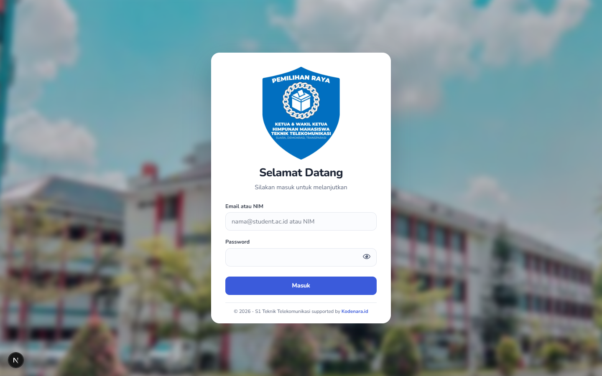
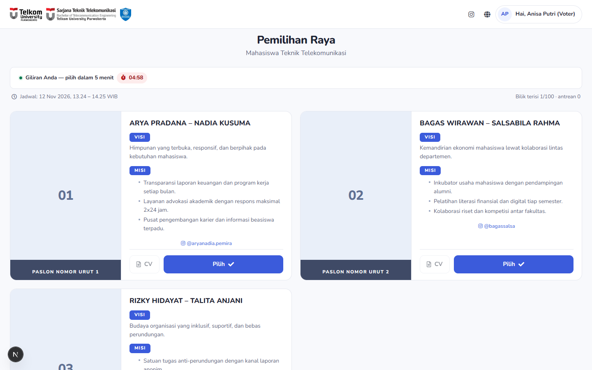
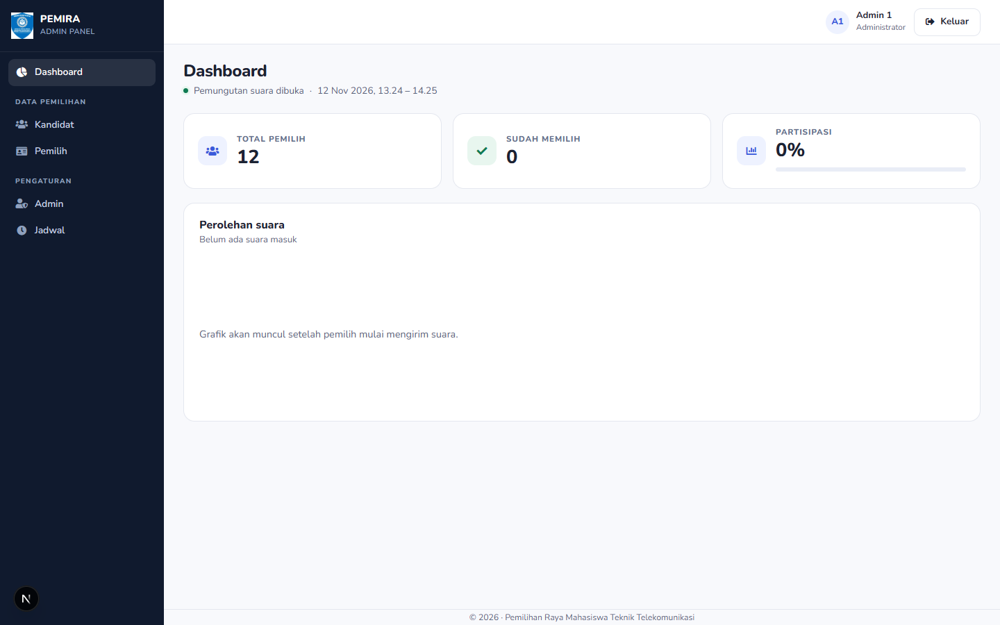
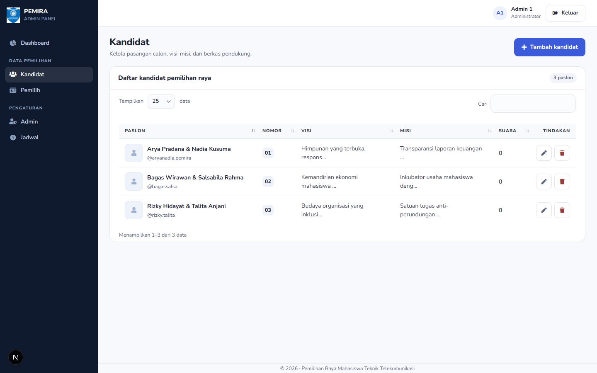
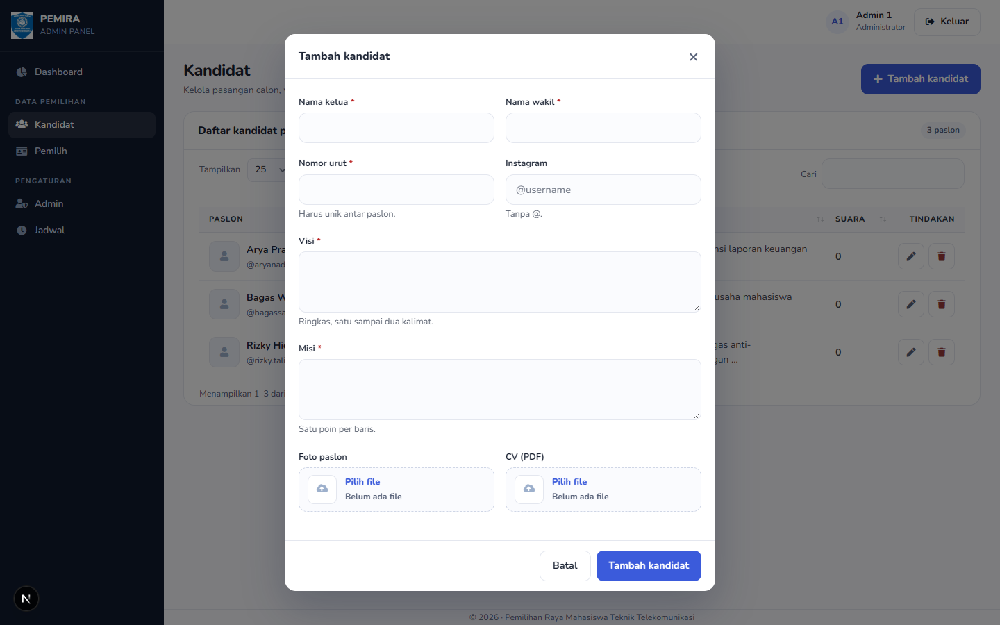
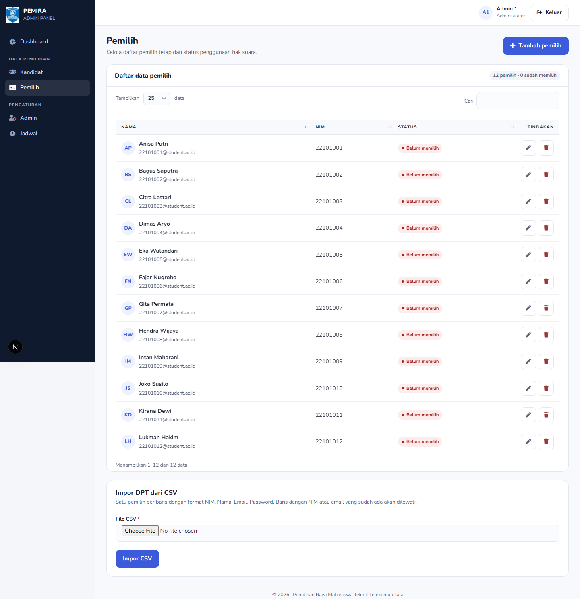

# PEMIRA — E-Voting

Sistem e-voting Pemilihan Raya Mahasiswa Teknik Telekomunikasi: bilik suara berantre,
surat suara rahasia, panel admin KPU, dan rekap hasil. Berbasis Next.js, Prisma, SQLite, NextAuth.

## Screenshots

| Login | Bilik suara |
|---|---|
|  |  |

| Dashboard admin | Kelola kandidat |
|---|---|
|  |  |

| Tambah kandidat | Daftar pemilih |
|---|---|
|  |  |

Tangkapan layar 1440×900 dari UI saat ini, tersimpan di `shots/`.

## Fitur inti

- **Surat suara rahasia**: tabel `Vote` tidak punya kolom identitas pemilih; `hasVoted` dicek atomik.
- **Antrean bilik suara**: FIFO, maks `MAX_ACTIVE_VOTERS` pemilih bersamaan, giliran 5 menit.
- **Sesi terkunci**: satu login aktif per akun (`sessionTag`), pemilih logout otomatis 60 detik setelah memilih.
- **Panel admin**: dashboard, DPT + impor CSV, paslon + visi/misi/CV, akun admin, jadwal & pengumuman.
- **Rekap hasil**: terkunci sampai pemungutan ditutup dan `announceAt` lewat.
- **Jadwal otomatis**: menyimpan jadwal meng-arm otomatisasi — pemungutan dibuka pada Mulai dan ditutup pada Selesai (dihitung tiap request, tanpa cron); tombol buka/tutup manual tetap berlaku langsung, dan bila rentang sudah lewat jendela diperpanjang ke waktu pengumuman.
- **Siap VPS kecil**: SQLite WAL, tanpa service database terpisah.

## Stack

`Next.js 15` · `Prisma 6` · `SQLite (WAL)` · `NextAuth (JWT)` · `SB Admin 2 / Bootstrap 4`

## Quick start

```bash
npm install
cp .env.example .env      # DATABASE_URL + AUTH_SECRET
npm run db:push           # creates prisma/pemira.db from prisma/schema.prisma (SQLite)
npm run db:seed           # RESET penuh: 2 admin, 12 pemilih, 3 paslon, 0 suara, jadwal hari ini 08:00–17:00
npm run dev               # http://localhost:3000
npm test                  # integritas suara + Bilik suara + Jadwal lewat satu interface
```

Seeded logins: `admin1@gmail.com / adminkesatu`, voters `22101001@student.ac.id … / password`.

`db:seed` **menghapus semua** user, paslon, suara, sesi, dan jadwal lalu mengisi ulang dari awal
(termasuk reset autoincrement). Jangan jalankan di database produksi berisi suara sah.

Database: **SQLite** (`prisma/pemira.db`) is the default — no service to install, no port, ~15–40 MB RAM,
enough for a few thousand voters on one small VPS. `lib/db.js` sets `journal_mode=WAL`,
`synchronous=FULL`, and `foreign_keys=ON` at startup, so a vote is never lost on a power cut and
readers are never blocked by a writer.

The PostgreSQL variant is kept in `prisma/schema.postgres.prisma`
(`npx prisma generate --schema prisma/schema.postgres.prisma` +
`prisma db push --schema prisma/schema.postgres.prisma`) if you later want a managed database.

Note: if `DATABASE_URL` is exported in your shell it overrides `.env` — Prisma and Next.js both prefer
the process environment. Keep them in sync, or unset the shell variable.
